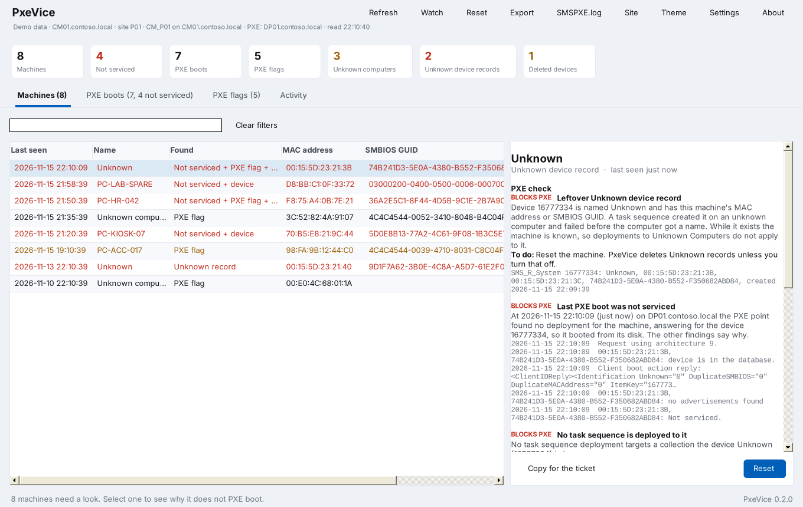
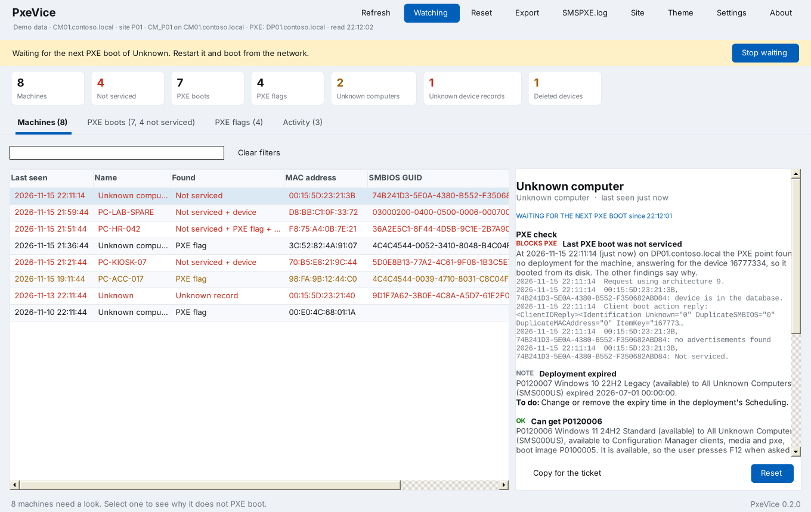
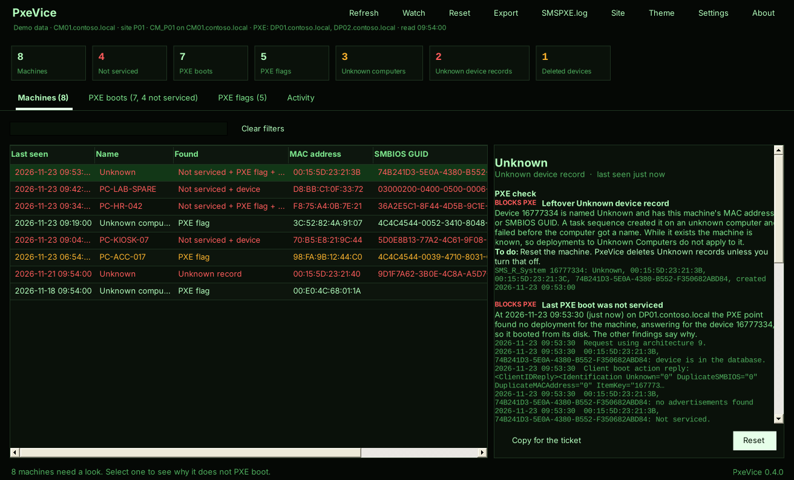
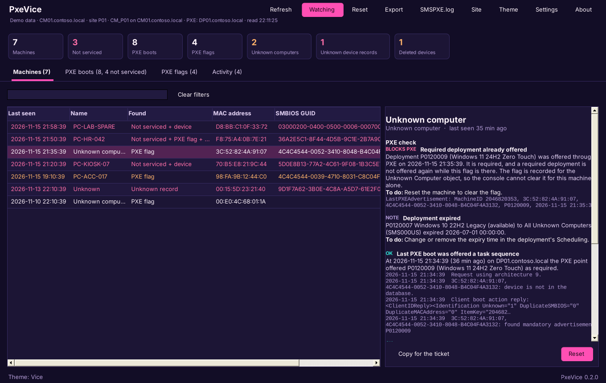

<p align="center"></p>

# PxeVice

PxeVice gets a machine PXE booting again in Configuration Manager. It shows every PXE boot from SMSPXE.log and what it got, checks why a machine is not offered a task sequence, and clears what the site keeps after a PXE boot, such as PXE flags and leftover Unknown device records. After a reset it waits for the next PXE boot and tells whether the machine got its task sequence.

It is a companion to [LogVice](https://github.com/Baldissera88/LogVice), [PolicyVice](https://github.com/Baldissera88/PolicyVice) and [TrackVice](https://github.com/Baldissera88/TrackVice): one portable exe, the same themes, and SMSPXE.log opens in LogVice with one click.



[docs/TESTING.md](docs/TESTING.md) is the checklist for checking PxeVice on a site.

## Download

Get `PxeVice.msi` or the portable `PxeVice.exe` from the [latest release](https://github.com/Baldissera88/PxeVice/releases/latest). It needs .NET Framework 4.5 or later, which Windows 10, Windows 11 and Windows Server 2016 and later have. The files are not code signed, so SmartScreen warns on the first start.

## Requirements

| For | What is needed |
|---|---|
| Running PxeVice | Windows 10 or 11, or Windows Server, with .NET Framework 4.5 or later. No install needed |
| The site | Network access and remote WMI to the SMS Provider. PxeVice finds the site code, the site database and every PXE distribution point from there |
| Reading | A role in Configuration Manager that can read devices, collections, deployments, task sequences, content status and the site's distribution points, such as Read-only Analyst |
| The site database | `SELECT` on `v_R_System`, `v_Advertisement` and `v_Package`, and `SELECT` on `LastPXEAdvertisement`, with Windows authentication |
| PXE boots | Read access to SMSPXE.log on the PXE distribution points, through `SMS_DP$`, the site's share or the administrative share |
| Reset | Rights to delete devices, and `DELETE` on `LastPXEAdvertisement` |
| Restarting the PXE service | Administrator on the distribution point |
| LogVice | Optional. When it is not found, the button asks you to locate LogVice.exe and keeps your choice |

These rights go to the account PxeVice connects with: the supporter's own account, or a [service account](#service-account) set in Settings. Either can be given exactly these rights in the site database instead of a broader role.

## Why a machine does not PXE boot

SMSPXE.log says `no advertisements found` and `Not serviced`, and the machine boots from its disk. PxeVice puts together what decides it:

| Finding | What it means |
|---|---|
| **Required deployment already offered** | A required deployment was offered through PXE and is recorded in `LastPXEAdvertisement`. It is not offered again until the flag is cleared. When the machine booted as unknown, the flag belongs to the Unknown Computer object, and the console can only clear it for every unknown machine at once |
| **Leftover Unknown device record** | A task sequence on an unknown computer created a device record and failed before the computer got a name, so the record is named `Unknown`. While it exists the machine is known, so deployments to Unknown Computers do not apply to it |
| **Last PXE boot was not serviced** | What SMSPXE.log says about the last boot, with the log lines |
| **No task sequence is deployed to it** | No task sequence deployment targets a collection the device, or the Unknown Computer objects, are in |
| **Deployment not available to PXE** | The deployment is made available to Configuration Manager clients only, not to media and PXE |
| **Deployment not available yet** or **expired** | The deployment's schedule keeps it from being offered now |
| **Boot image not on the PXE distribution point** | The PXE point only offers a task sequence whose boot image it has |
| **Unknown computer support is off** | The machine boots as unknown, and the distribution point does not answer unknown computers |
| **Duplicate SMBIOS GUID** or **MAC address** | More than one record has it, such as a firmware that reports the same GUID on many machines, or a shared USB network adapter |
| **Several device records** | The PXE point answers for one of them, which may not be the one the deployment is for |
| **PXE flag for a deleted device** | The device was deleted, but its PXE flag stayed |
| **Can get** | A deployment the machine is offered when it PXE boots, with its collection and boot image |

Each finding says what happened, what to do, and the evidence: the log lines, the table row or the device record.

## What it shows

| Part | Contents |
|---|---|
| Counts | Machines, not serviced, PXE boots, PXE flags, unknown computers, Unknown device records and deleted devices. Click one to filter |
| Machines | One line per machine with something left behind, or a PXE boot that was not serviced, newest first. Matched on the SMBIOS GUID, or on the MAC address when there is no GUID |
| PXE check | For the selected machine: the findings, the machine's MAC addresses, SMBIOS GUID, device records and PXE flags, its last PXE boots, and what a reset will do |
| PXE boots | Every PXE boot in SMSPXE.log: the time, the machine, what it got, the MAC address, the SMBIOS GUID, the resource the site answered for, the architecture and the server, with the log lines behind it |
| PXE flags | Every row in `LastPXEAdvertisement`, with the device or Unknown Computer object it belongs to and the task sequence name |
| Activity | The changes made in this session, and the next PXE boot after each reset |


## Reset

Select one or more machines and press **Reset** (Ctrl+R). PxeVice reads the site again and shows every change before it makes them:

1. Clear the PXE flag with **Clear Required PXE Deployments**, the method the console uses
2. Delete the device records named `Unknown` for the machine. Named devices are only deleted when you turn that on
3. Delete the machine's rows that are still in `LastPXEAdvertisement`, such as flags of unknown computers and deleted devices
4. Restart the PXE service (WDSServer or SccmPxe) on the PXE distribution points, when you turn that on. On another computer this is done as the service account, which must be a local administrator there. On the PXE server itself PxeVice must run as administrator, and offers to start again as administrator when it does not. It turns on by itself when you delete named devices

Deleting a named device only marks it decommissioned: it is gone from the console at once, and the site database removes it later with Delete Aged Discovery Data. PxeVice reads the site again after the deletion and says if the device is still listed. The PXE point remembers a device for a while, so a machine can be answered as the deleted device until the PXE service is restarted. If the next PXE boot is, PxeVice says so and offers to restart the service.

Then PxeVice starts watching and waits for the machine's next PXE boot. Boot it from the network: the status bar and the Activity tab say whether it was offered a task sequence, or why not.



Microsoft does not support direct changes to the site database. PxeVice uses the supported method first, and only deletes rows of the machines you selected.

### Shared network adapters

Many machines can PXE boot with the same USB network adapter, so a MAC address is not always one machine. When a machine has an SMBIOS GUID, PxeVice matches other records on its MAC address only when they have no GUID, so the flags of other machines with the same adapter stay. Without a GUID, named devices that have used the same MAC address are left alone when there is more than one, and the reset page says so. When more than 25 rows match one machine, PxeVice deletes none of them.

## Watch

**Watch** (Ctrl+W) reads the site and the new lines of SMSPXE.log every 10 seconds, and says in the status bar when a PXE boot comes in. The taskbar button flashes when PxeVice is in the background. When it connects, PxeVice reads up to 8 MB of SMSPXE.log and the rolled-over SMSPXE.lo_; after that only new lines.

## PXE distribution points

PxeVice finds every distribution point with PXE turned on from the site, and reads SMSPXE.log on all of them at the same time, so a slow or unreachable server does not hold up the rest: its lines come with a later read. With more than four, less of each log is read when PxeVice connects, 32 MB in all and at least 1 MB each. Settings lists the ones found. **More PXE distribution points** adds servers the site does not list; turn off **Find the PXE distribution points from the site** to use only the servers you give.

## Service account

When supporters do their work through a service account, PxeVice can use it too. Write the account in **Settings > Service account**, as `DOMAIN\name` or `name@domain`, and press **Use it now**. PxeVice asks for the password and connects again with the account for the network, like `runas /netonly`. It does not restart, and needs neither the Secondary Logon service nor administrator rights:

- On the PC the supporter is still themselves: their settings, their files and their name in the activity log
- Over the network PxeVice is the service account: the SMS Provider, the site database, SMSPXE.log and the PXE service. The supporter needs no rights of their own there
- The activity log, the Activity tab and reports say both, such as `CONTOSO\supporter as CONTOSO\svc-pxevice`

The password can be remembered for the supporter's Windows user, encrypted with DPAPI, so PxeVice uses the account when it opens, without asking. **Forget the password** removes it. Windows checks the password the first time PxeVice connects: a wrong one shows as a failed connection.

The service account is only used over the network. On the site server itself the connections are local and use the supporter's own account, so run PxeVice from another PC. The command line uses the account when its password is remembered; `/ownaccount` uses your own account. SMSPXE.log opens in LogVice as a copy read with the account, since LogVice runs with your own account.

## Updates

Once a day when it opens, PxeVice asks GitHub for the latest release and shows a banner when there is a newer one. **Update** (in the banner, and in Settings > Updates) shows the release notes and the release page, and **Install** when it can. Nothing about you or the site is sent: it is one request for the latest release of `Baldissera88/PxeVice`, like a browser would make. `PxeVice.exe /checkupdate` does the same from the command line.

Installing from PxeVice is **off** until you turn on *Install updates from PxeVice* in Settings > Updates, since the MSI needs administrator rights and a supporter may not have them. When it is on, **Install** downloads the MSI (or `PxeVice.exe` when this copy was not installed with the MSI), checks it against `SHA256SUMS.txt` from the same release, closes PxeVice, installs it and opens it again. A file that does not match its checksum is deleted and not installed.

To turn it off for everyone, set these values on the PC, for example with a policy:

| Value in `HKLM\SOFTWARE\Policies\PxeVice` | Type | Effect |
|---|---|---|
| `DisableUpdateCheck` | DWORD, 1 | No update check, and no install |
| `DisableUpdateInstall` | DWORD, 1 | The check still runs, but there is no Install button |

Install is offered when the release has `PxeVice.msi` (or `PxeVice.exe`) and a checksum for it: `SHA256SUMS.txt` in the release, or the SHA-256 that GitHub gives for each file. Without one, PxeVice shows the release page and says why.

## Sites

**Site** in the toolbar switches between saved sites, such as one per customer. **Save this site as** keeps the site server, the site database, the PXE distribution points and where SMSPXE.log is under a name. On the command line, `/use <name>` uses a saved site.

## Reports

**Export** (Ctrl+E) saves an HTML report of the selected machines for the ticket: the PXE check with its evidence, the PXE boots and the changes made in this session. It follows the light or dark mode of the browser and has a print layout. **Copy for the ticket** puts the check on the clipboard as text. **PXE boots as CSV** saves the PXE boots tab.

## Activity log

Every change, and every next PXE boot after a reset, is written to `%LOCALAPPDATA%\PxeVice\PxeVice.log` in the CMTrace format, with who made it. **Open the activity log in LogVice** on the Activity tab opens it.

## Themes

Settings shows seven choices as tiles: **System** (follows the Windows app mode), **Light**, **Dark**, **Vice** (the default), and **Terminal**, **Amber** and **Synthwave**. Terminal and Amber have square corners and show counts in a monospace font. They are the same themes as in TrackVice. The Theme button in the toolbar steps through them, and `--theme <name>` starts PxeVice with one for that run only.




## Settings

**Settings** (Ctrl+,) holds the theme, the service account, the site server, SQL Server, site database and PXE distribution points when they are not found, where SMSPXE.log is, the saved sites, whether Unknown records are deleted and the PXE service restarted by default, how often Watch reads, whether to watch after a reset or when PxeVice opens, how far back PXE boots are shown (1 hour to 3 days), and where LogVice is. They are kept in `HKCU\Software\PxeVice`.



## Try it without a site

`PxeVice.exe --demo` opens a site with typical cases: a machine with a leftover Unknown record after a failed task sequence, a device whose required deployment was already offered, a kiosk PC whose deployment is for clients only, a spare PC with a firmware SMBIOS GUID that many machines share, a deleted device with its flag, and a USB network adapter. Its SMSPXE.log lines are read through the same code as a real log, and a machine that is reset PXE boots again after a few seconds. The screenshots in this README come from it.

## Command line

```text
PxeVice.exe                            Open the window
PxeVice.exe --demo                     Open the demo

PxeVice.exe /list                      List machines with leftover PXE data or a PXE boot that was not serviced
PxeVice.exe /requests [/hours <n>]     List the PXE boots in SMSPXE.log (default the last 24 hours, 0 for all)
PxeVice.exe /check /mac <mac>          Check why a machine does not PXE boot. Also with /guid <guid> or /name <name>
PxeVice.exe /report <file.html>        Save a report of a machine (with /mac, /guid or /name) or of every listed machine
PxeVice.exe /reset /mac <mac>          Reset a machine. Also with /guid <guid> or /name <name>
  /whatif                              Show what /reset would change, and change nothing
  /removedevice                        Also delete named device records that match
  /keepunknown                         Do not delete device records named Unknown
  /restartpxe                          Restart the PXE service afterwards (on by default with /removedevice)
  /keeppxe                             Do not restart the PXE service, also with /removedevice
  /checkupdate                         Ask GitHub if there is a newer PxeVice

  /use <name>                          Use a site saved in PxeVice
  /site <server>                       The site server with the SMS Provider (default: this computer or Settings)
  /sql <server> /db <name>             The site database, when it is not found from the SMS Provider
  /pxe <servers>                       PXE distribution points, separated by commas
```

A MAC address can be written with colons, dashes or nothing in between. The exit code is 0 when done, 1 on an error, and 2 when nothing was found for the machine, or for `/check` when something blocks PXE. In PowerShell, use `Start-Process -Wait -PassThru` to get it.

```powershell
.\PxeVice.exe /check /mac 00-15-5D-23-21-3B
.\PxeVice.exe /reset /mac 00-15-5D-23-21-3B /whatif
```

## Keyboard

| Key | Action |
|---|---|
| F5 | Read the site and SMSPXE.log again |
| Ctrl+W | Start or stop watching |
| Ctrl+R | Reset the selected machines |
| Ctrl+E | Report of the selected machines |
| Ctrl+L | Open SMSPXE.log in LogVice |
| Ctrl+F | Search machines and PXE boots |
| Ctrl+1 to Ctrl+4 | Machines, PXE boots, PXE flags, Activity |
| Ctrl+C | Copy the selected row |
| Ctrl+, | Settings |
| F1 | About and the command line |
| Esc | Clear the search, or close a page |

## Privacy and safety

Reading, watching, the PXE check and reports change nothing. PxeVice talks to the SMS Provider, the site database and the PXE distribution points you name, and, once a day, to GitHub to ask for the latest release (turn it off in Settings > Updates or with a policy value). It talks to nothing else.

A service account's password is only kept when you choose to, encrypted with DPAPI for your Windows user in `HKCU\Software\PxeVice`. A supporter who can start PxeVice with the account can do everything the account can do, so give it only the rights in [Requirements](#requirements).

A reset changes the site only after you confirm the list of changes: it clears PXE flags, deletes device records and rows in `LastPXEAdvertisement`, and restarts the PXE service when you choose it. Every change is written to the activity log with the Windows account that made it.

## Limitations

- Microsoft does not document the lines of SMSPXE.log. PxeVice reads the MAC address and SMBIOS GUID at the start of a line, the architecture, the boot action reply and the words `no advertisements found` and `Not serviced`. Lines it does not recognise are left out.
- Whether a deployment is available to PXE is read from the deployment's flags in `SMS_Advertisement`, and its schedule from its available and expiry times.
- The PXE check reads collection membership as the site has it now. A collection that has not been evaluated since a device was added shows the old membership.
- The check looks at deployments, boot images and the distribution point. Network causes, such as DHCP options, IP helpers or a firewall, are not visible to it: when the machine's PXE boots are missing from SMSPXE.log, the request did not reach the PXE point.
- Direct changes to the site database are not supported by Microsoft. PxeVice only deletes rows the supported method did not clear.
- The service account works over the network only, like `runas /netonly`. On the site server PxeVice connects locally with the supporter's own account.
- The exe and MSI are unsigned. SmartScreen warns on downloaded copies, and AppLocker or WDAC need them signed with your own certificate.

## Build from source

On Windows, with the C# compiler that ships with .NET Framework:

```powershell
.\build.ps1          # PxeVice.exe
.\build.ps1 -Msi     # and PxeVice.msi, with WiX Toolset 3
.\bump.ps1 0.3.0     # set a new version
```

On Linux, with Mono and msitools: `./build.sh` builds the exe, `./package.sh` the exe and the MSI, `./tests/run.sh` runs the tests, and `./bump.sh 0.3.0` sets a new version. The GitHub workflow builds both files, runs the tests and attaches the files to a release.

## Roadmap

What is planned next is in [ROADMAP.md](ROADMAP.md).

## License

MIT. See [LICENSE](LICENSE).

## Author

Daniel L. Baldissera
