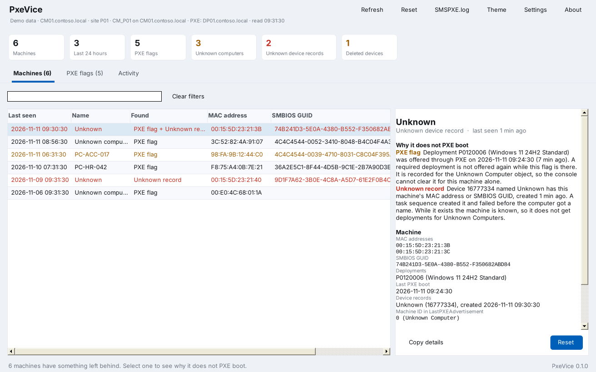
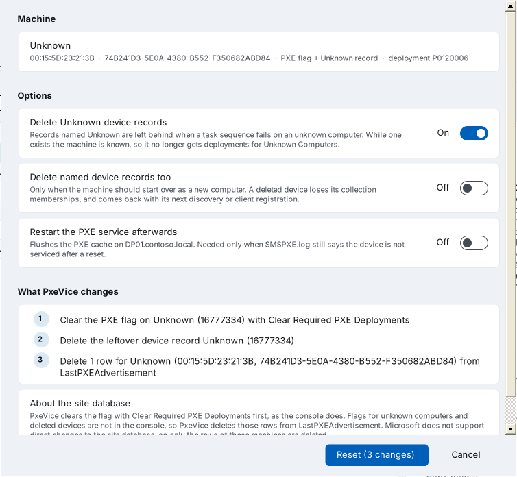
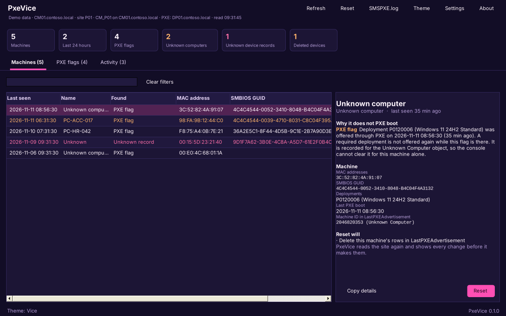

<p align="center"></p>

# PxeVice

PxeVice gets a machine PXE booting again in Configuration Manager. It finds what the site keeps after a PXE boot (PXE flags, leftover Unknown device records and flags of deleted devices), shows why each machine is not offered a task sequence, and clears it with one click.

It is a companion to [LogVice](https://github.com/Baldissera88/LogVice) and [PolicyVice](https://github.com/Baldissera88/PolicyVice): one portable exe, the same themes, and SMSPXE.log opens in LogVice with one click.



## Why a machine stops PXE booting

SMSPXE.log says `no advertisements found` and `Not serviced`, and the machine boots to its disk. The usual reasons:

| Found | What happened | Why the console does not help |
|---|---|---|
| **PXE flag** | A required deployment was offered through PXE. It is recorded in `LastPXEAdvertisement` and is not offered again until the flag is cleared. | When the machine booted as unknown, the flag belongs to the x64, x86 or ARM64 Unknown Computer object. **Clear Required PXE Deployments** on the Unknown Computers collection clears it for every unknown machine, not for this one. |
| **Unknown record** | A task sequence on an unknown computer created a device record and failed before the computer got a name, so the record is named `Unknown`. | While it exists the machine is known, so it no longer gets deployments for Unknown Computers, and it is easy to miss among the devices. |
| **Deleted device** | The device was deleted from the console, but its PXE flag stayed. | The flag points to a device that no longer exists, so the console cannot show or clear it. |

PxeVice puts the PXE flags and the Unknown records side by side, one line per machine. It matches them on the SMBIOS GUID, or on the MAC address when there is no GUID. The newest machine is at the top, so the one that just failed to PXE boot is usually the first line, without looking up its MAC address.

## Reset

Select one or more machines and press **Reset** (or Ctrl+R). PxeVice reads the site again and shows every change before it makes them:

1. Clear the PXE flag with **Clear Required PXE Deployments**, the method the console uses
2. Delete the device records named `Unknown` for the machine. Named devices are only deleted when you turn that on
3. Delete the machine's rows that are still in `LastPXEAdvertisement`, such as flags of unknown computers and deleted devices
4. Restart the PXE service (WDSServer or SccmPxe) on the PXE distribution points, when you turn that on



Microsoft does not support direct changes to the site database. PxeVice uses the supported method first, and only deletes rows of the machines you selected.

### Shared network adapters

Many machines can PXE boot with the same USB network adapter, so a MAC address is not always one machine. When a machine has an SMBIOS GUID, PxeVice matches other records on its MAC address only when they have no GUID, so the flags of other machines with the same adapter stay. Without a GUID, named devices that have used the same MAC address are left alone when there is more than one, and the reset page says so. When more than 25 rows match one machine, PxeVice deletes none of them.

### Activity log

Every change is written to `%LOCALAPPDATA%\PxeVice\PxeVice.log` in the CMTrace format, with who made it. The **Activity** tab shows the changes of this session, and opens the log in LogVice.

## What it shows

| Tab | Contents |
|---|---|
| Machines | One line per machine: what is left, MAC address, SMBIOS GUID and deployment. Select a machine to see why it does not PXE boot and what a reset will do |
| PXE flags | Every row in `LastPXEAdvertisement`, with the device or Unknown Computer object it belongs to and the task sequence name |
| Activity | The changes made in this session |

Click a count at the top to filter: machines from the last 24 hours, unknown computers, Unknown device records or deleted devices.



## Connecting

PxeVice connects to the SMS Provider on the site server, and finds the site code, the site database and the PXE distribution points from there. Run it on the site server, or set the site server in **Settings**. The SQL Server, database and PXE distribution points can also be set there when they are not found.

The account needs:

- Rights in Configuration Manager to read and delete devices
- In the site database: `SELECT` on `v_R_System`, `v_Advertisement` and `v_Package`, and `SELECT` and `DELETE` on `LastPXEAdvertisement`
- Administrator rights on the distribution point to restart the PXE service

A supporter account can be given exactly these rights in the site database instead of a broader role.

## Command line

```
PxeVice.exe                          Open the window
PxeVice.exe /list                    List machines with leftover PXE data, newest first
PxeVice.exe /reset /mac <mac>        Reset a machine by MAC address
PxeVice.exe /reset /guid <guid>      Reset a machine by SMBIOS GUID
PxeVice.exe /reset /name <name>      Reset a device by name
  /whatif                            Show what /reset would change, and change nothing
  /removedevice                      Also delete named device records that match
  /keepunknown                       Do not delete device records named Unknown
  /restartpxe                        Restart the PXE service afterwards
  /site <server>                     The site server with the SMS Provider
  /sql <server> /db <name>           The site database, when it is not found from the SMS Provider
  /pxe <servers>                     PXE distribution points, separated by commas
  --demo                             Use sample data
```

A MAC address can be written with colons, dashes or nothing in between. Exit codes: 0 when done, 1 on an error, 2 when nothing was found for the machine.

```powershell
.\PxeVice.exe /reset /mac 00-15-5D-23-21-3B /whatif
```

## Download and install

Download `PxeVice.exe` from [Releases](../../releases) to run it without installing, or `PxeVice.msi` to install it for all users:

```powershell
msiexec /i PxeVice.msi /qn
```

PxeVice needs .NET Framework 4.5 or later, which Windows 10, Windows 11 and Windows Server 2016 and later already have.

## Building

On Windows, with the C# compiler that ships with .NET Framework:

```powershell
.\build.ps1          # PxeVice.exe
.\build.ps1 -Msi     # and PxeVice.msi, with WiX Toolset 3
```

On Linux, with Mono and msitools: `./build.sh` builds the exe, `./package.sh` the exe and the MSI, and `./tests/run.sh` runs the tests. The GitHub workflow builds both files, runs the tests and attaches the files to a release.

## License

MIT. See [LICENSE](LICENSE).
