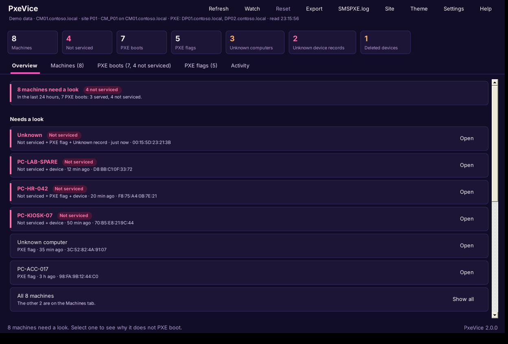
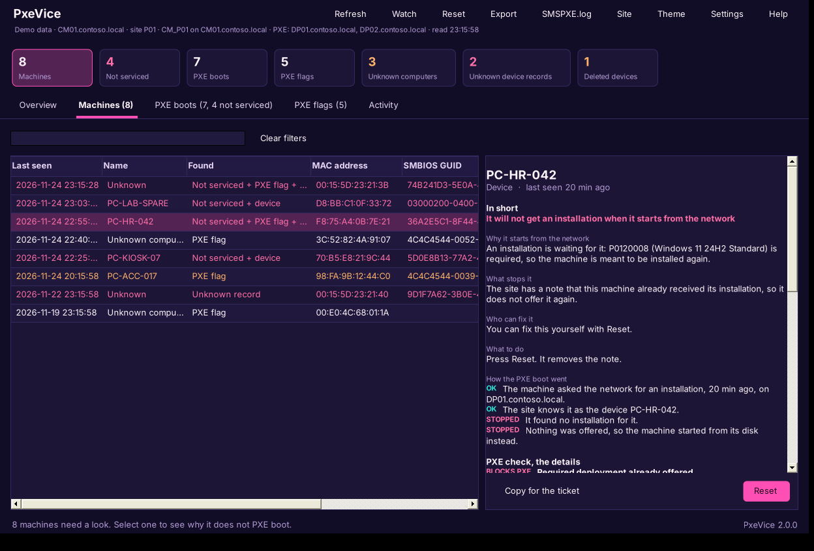
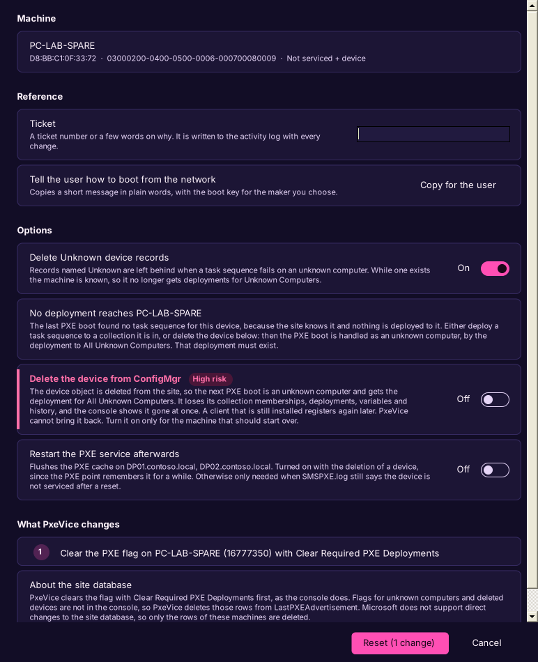
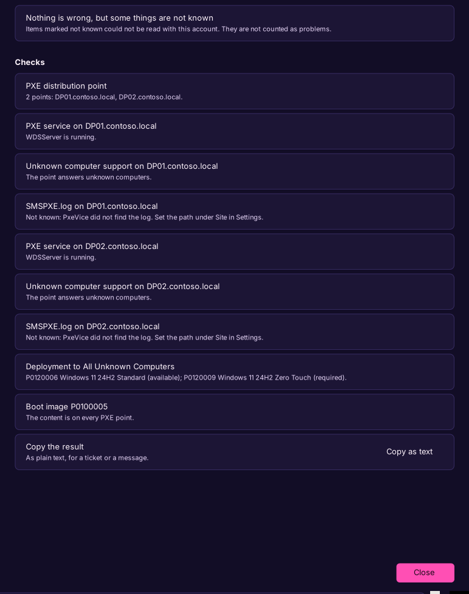
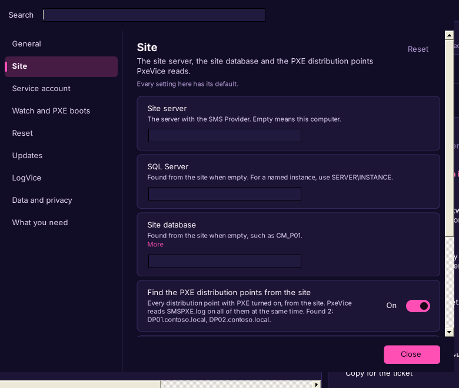
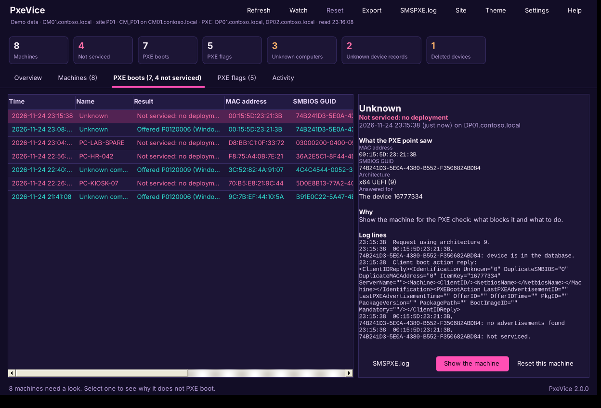
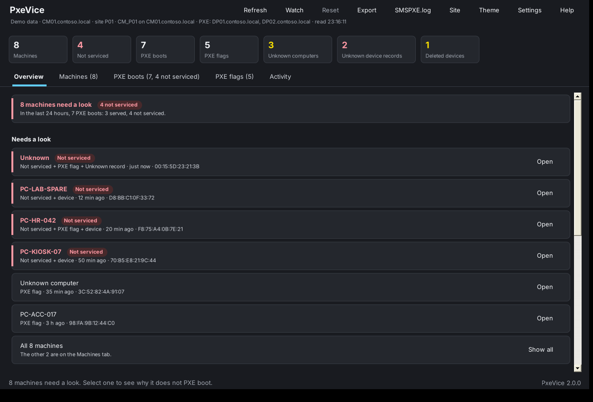
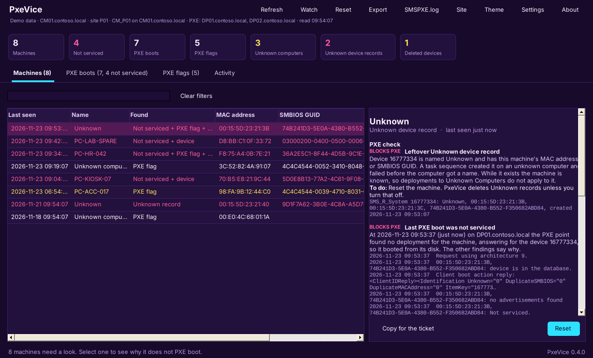
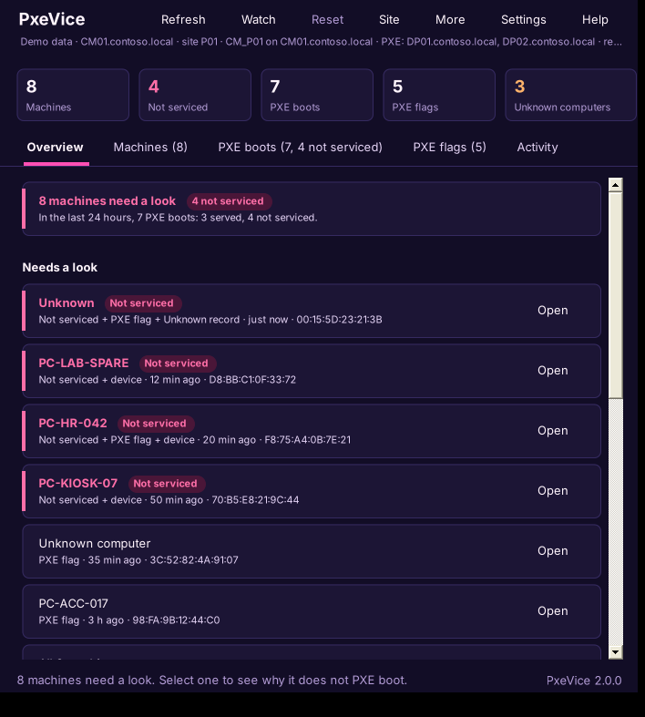

<p align="center">
  
</p>

<h1 align="center">PxeVice</h1>

<p align="center">
  Get a machine PXE booting again in Configuration Manager, and see in plain words why it did not.
</p>

<p align="center">
  
  <a href="../../actions/workflows/build.yml"></a>
  
  
  
  <a href="LICENSE"></a>
</p>



A machine that should PXE boot starts from its disk instead, and SMSPXE.log says `no advertisements found` and `Not serviced`. PxeVice shows every PXE boot from SMSPXE.log, says **in plain words** why a machine is not offered a task sequence, and clears what the site keeps after a PXE boot: PXE flags in `LastPXEAdvertisement`, leftover **Unknown** device records and flags of deleted devices. After a reset it waits for the next PXE boot and tells whether the machine got its task sequence.

You do not need to know ConfigMgr to read the answer. Supporters get a short diagnosis they can act on, and a ConfigMgr administrator gets the log lines and the evidence behind it.

It is one portable exe with an MSI for deployment, and a companion to [LogVice](https://github.com/Baldissera88/LogVice), [PolicyVice](https://github.com/Baldissera88/PolicyVice) and [TrackVice](https://github.com/Baldissera88/TrackVice): the same themes, the same Help and Settings, and SMSPXE.log opens in LogVice with one click. Free and open source under the MIT license.

## Features

- **A diagnosis in plain words.** For the selected machine, **In short** says whether it will get an installation, why it starts from the network, what stops it, who can fix it (you with Reset, or a ConfigMgr administrator) and what to do, then how the PXE boot went step by step. The technical findings follow, with the log lines.
- **Overview.** What the last day looked like, which machines need a look (the ones that were not serviced first), what is left behind most often, and the machines you opened lately.
- **Every PXE boot, from every PXE point.** SMSPXE.log is read on all PXE distribution points at the same time, with the MAC address, SMBIOS GUID, architecture, what the site answered and the log lines behind it. **Watch** follows new boots as they come in.
- **A reset that shows its changes first.** Clear the flag the way the console does, delete leftover Unknown records and the machine's remaining rows, and restart the PXE service. Every change is listed before you press Reset, and logged with who made it.
- **Deleting a device is marked high risk.** For a device that exists but has no deployment, deleting it makes the next PXE boot an unknown computer. It is red, off by default, asks twice, and PxeVice writes what it knew about the device to a file first. If that file cannot be written, nothing is deleted.
- **Safe with shared hardware.** A USB network adapter or a firmware SMBIOS GUID that many machines share never makes PxeVice touch other machines.
- **PXE health of the site.** The PXE points, their services, unknown computer support, the deployment to All Unknown Computers and the boot image, in one list. Anything PxeVice cannot read is shown as *not known*, not as a problem.
- **For teams.** A ticket number goes into the activity log with every change. Administrators can make PxeVice read only, forbid device deletion, require a ticket and limit how many machines one reset can touch, with a policy.
- **Tell the user how to boot.** **Copy for the user** writes a short message with the boot key for Dell, HP, Lenovo, Surface, Hyper-V or VMware.
- **Service account.** Connect to the site with a service account over the network, like `runas /netonly`, while you stay yourself on the PC. The log says both.
- **Reports and a command line.** An HTML report for the ticket, **Copy for the ticket**, and `/check`, `/reset`, `/health` and more for scripts.
- **Updates you can verify.** Once a day PxeVice asks GitHub for the latest release. **Install** checks the download against the release checksums first. Turn it off for everyone with a policy.
- **Your look.** Seven themes, from Vice to Terminal, a narrow window that folds the buttons into **More**, and Back and Forward like a browser.
- **Try it without a site.** `PxeVice.exe --demo` opens a site with typical cases.

<table>
  <tr>
    <td></td>
    <td></td>
  </tr>
  <tr>
    <td align="center">The answer for one machine, in plain words</td>
    <td align="center">The reset shows every change, and marks the risky one</td>
  </tr>
  <tr>
    <td></td>
    <td></td>
  </tr>
  <tr>
    <td align="center">PXE health of the site</td>
    <td align="center">Settings by subject, with search</td>
  </tr>
</table>

## Download

Get the latest version from [Releases](../../releases). Pick the package that suits you:

| Package | Use it when |
|---|---|
| `PxeVice.msi` | You deploy to many PCs with Intune or ConfigMgr. Installs per machine and adds a Start menu shortcut |
| `PxeVice.exe` | You want a portable tool on a USB stick, a share or a jump server. No install needed |
| `SHA256SUMS.txt` | Checksums of the exe and MSI, to check a download |

Every release is built by [GitHub Actions](../../actions/workflows/build.yml) from the source in this repository, not on a private PC. Check that a file you downloaded is exactly what GitHub built:

```powershell
Get-FileHash .\PxeVice.msi -Algorithm SHA256     # compare with SHA256SUMS.txt
gh attestation verify .\PxeVice.msi -R Baldissera88/PxeVice
```

The files are not code signed, so SmartScreen warns on the first start.

## Requirements

- Windows 10, Windows 11 or Windows Server 2016 or later, with .NET Framework 4.5 or later. Every supported Windows has it, and nothing extra is installed.
- Network access and remote WMI to the SMS Provider of the site. PxeVice finds the site code, the site database and every PXE distribution point from there.

| For | What is needed |
|---|---|
| Reading | A role in Configuration Manager that can read devices, collections, deployments, task sequences, content status and the site's distribution points, such as Read-only Analyst |
| The site database | `SELECT` on `v_R_System`, `v_Advertisement` and `v_Package`, and `SELECT` on `LastPXEAdvertisement`, with Windows authentication |
| PXE boots | Read access to SMSPXE.log on the PXE distribution points, through `SMS_DP$`, the site's share or the administrative share |
| Reset | Rights to delete devices, and `DELETE` on `LastPXEAdvertisement` |
| Restarting the PXE service | Administrator on the distribution point |
| LogVice | Optional. When it is not found, the button asks you to locate LogVice.exe and keeps your choice |

These rights go to the account PxeVice connects with: the supporter's own account, or a [service account](#service-account) set in Settings. **Settings > What you need** lists them too.

## Deploy with Intune or ConfigMgr

The MSI installs per machine, needs no restart and upgrades any earlier version in place. It closes a running PxeVice first.

| Setting | Value |
|---|---|
| Install command | `msiexec /i PxeVice.msi /qn` |
| Uninstall command | `msiexec /x {6B98716C-E550-40A0-A97C-595D8E7EEBF2} /qn` |
| Detection | MSI product code `{6B98716C-E550-40A0-A97C-595D8E7EEBF2}` (version 2.0.0) |
| Upgrade code | `{BAC16563-96B0-438B-879E-8C73285C0DDC}` (the same for every version) |
| Install context | System |

Each new version has a new product code, in the release notes. Add it as a new app that supersedes the earlier one.

Use the administrative template in [`policy/`](policy) to set the rules for everyone: import `PxeVice.admx` and `en-US/PxeVice.adml` in Intune under **Devices > Configuration > Import ADMX**, or copy them to the Group Policy central store. The policies set these values under `HKLM\SOFTWARE\Policies\PxeVice`, as DWORDs:

| Value | Data | Effect |
|---|---|---|
| `DisableUpdateCheck` | `1` | No update check, no Update button, and no install |
| `DisableUpdateInstall` | `1` | The check still runs, but there is no Install button |
| `ReadOnly` | `1` | A reset is not started, in the window or on the command line |
| `DisableDeviceDeletion` | `1` | A reset that deletes a device is not started. Clearing flags still works |
| `RequireTicket` | `1` | A reset needs a ticket or reference |
| `MaxMachinesPerReset` | a number | A reset of more machines than this is not started |

## What it shows

| Part | Contents |
|---|---|
| Counts | Machines, not serviced, PXE boots, PXE flags, unknown computers, Unknown device records and deleted devices. Click one to filter |
| Overview | The last day, the machines that need a look, what is left behind most often, and the machines opened lately |
| Machines | One line per machine with something left behind, or a PXE boot that was not serviced, newest first. Matched on the SMBIOS GUID, or on the MAC address when there is no GUID. Search finds a MAC address with dashes, colons, dots or none, and a GUID with or without braces |
| In short, PXE check | For the selected machine: first a short answer in plain words (will it get an installation, why it starts from the network, what stops it, who can fix it, what to do, and how the PXE boot went step by step), then the findings, the machine's MAC addresses, SMBIOS GUID, device records and PXE flags, its last PXE boots, and what a reset will do |
| PXE boots | Every PXE boot in SMSPXE.log: the time, the machine, what it got, the MAC address, the SMBIOS GUID, the resource the site answered for, the architecture and the server, with the log lines behind it |
| PXE flags | Every row in `LastPXEAdvertisement`, with the device or Unknown Computer object it belongs to and the task sequence name |
| Activity | The changes made in this session, and the next PXE boot after each reset |



## Overview

The first tab. It says what the last day looked like (how many PXE boots came in, how many were served and how many were not), how many machines need a look, with the ones that were not serviced first and **Open** next to each, what is left behind most often, the machines you opened lately, and links to the PXE health and Help. The time it looks back follows **PXE boots from the last** in Settings.

**Alt+Left** and **Alt+Right**, and the mouse's back and forward buttons, go between the tabs and machines you looked at, like a browser.

## PXE health of the site

**Help > PXE health of the site**, the Overview, or `PxeVice.exe /health`. The PXE check looks at one machine; this looks at what every machine depends on: that a PXE point exists and its PXE service runs, that it answers unknown computers, that a task sequence is deployed to All Unknown Computers and available to media and PXE, that the boot image is on every PXE point, and that SMSPXE.log can be read. Each line is OK, a PROBLEM with what to do, or *not known* when this account could not read it. `/health` exits with 0, or 2 when something stops PXE.


## Why a machine does not PXE boot

SMSPXE.log says `no advertisements found` and `Not serviced`, and the machine boots from its disk. PxeVice puts together what decides it:

| Finding | What it means |
|---|---|
| **Required deployment already offered** | A required deployment was offered through PXE and is recorded in `LastPXEAdvertisement`. It is not offered again until the flag is cleared. When the machine booted as unknown, the flag belongs to the Unknown Computer object, and the console can only clear it for every unknown machine at once |
| **Leftover Unknown device record** | A task sequence on an unknown computer created a device record and failed before the computer got a name, so the record is named `Unknown`. While it exists the machine is known, so deployments to Unknown Computers do not apply to it |
| **Last PXE boot was not serviced** | What SMSPXE.log says about the last boot, with the log lines |
| **No task sequence is deployed to it** | No task sequence deployment targets a collection the device, or the Unknown Computer objects, are in |
| **Deployment not available to PXE** | The deployment is made available to Configuration Manager clients only, not to media and PXE |
| **Deployment not available yet** or **expired** | The deployment's schedule keeps it from being offered now |
| **Boot image not on the PXE distribution point** | The PXE point only offers a task sequence whose boot image it has |
| **Unknown computer support is off** | The machine boots as unknown, and the distribution point does not answer unknown computers |
| **Duplicate SMBIOS GUID** or **MAC address** | More than one record has it, such as a firmware that reports the same GUID on many machines, or a shared USB network adapter |
| **Several device records** | The PXE point answers for one of them, which may not be the one the deployment is for |
| **PXE flag for a deleted device** | The device was deleted, but its PXE flag stayed |
| **Can get** | A deployment the machine is offered when it PXE boots, with its collection and boot image |

Each finding says what happened, what to do, and the evidence: the log lines, the table row or the device record.

## Reset

Select one or more machines and press **Reset** (Ctrl+R), or press **Reset this machine** on a PXE boot. PxeVice reads the site again and shows every change before it makes them:

1. Clear the PXE flag with **Clear Required PXE Deployments**, the method the console uses
2. Delete the device records named `Unknown` for the machine. Named devices are only deleted when you turn on **Delete the device from ConfigMgr**, which is marked high risk, and PxeVice asks again before it does. Use it for a device that exists but has no deployment: it then boots as an unknown computer and gets the deployment for All Unknown Computers. The device loses its collection memberships, deployments and variables
3. Delete the machine's rows that are still in `LastPXEAdvertisement`, such as flags of unknown computers and deleted devices
4. Restart the PXE service (WDSServer or SccmPxe) on the PXE distribution points, when you turn that on. On another computer this is done as the service account, which must be a local administrator there. On the PXE server itself PxeVice must run as administrator, and offers to start again as administrator when it does not. It turns on by itself when you delete named devices


**Ticket.** Write a ticket number or a few words on why. It is written to the activity log with every change, and `/ticket` does the same on the command line. An administrator can require it.

**A file before a device is deleted.** Before a device is deleted, PxeVice writes what it knows about the machine (its device records, MAC addresses, SMBIOS GUID and PXE flags, and the list of changes) to `%LOCALAPPDATA%\PxeVice\resets`. If the file cannot be written, nothing is deleted. It is a record to read, since a deleted device cannot be made again from PxeVice.

**Tell the user how to boot.** **Copy for the user** puts a message on the clipboard in plain words: plug in the cable, press the boot key (F12 on Dell and Lenovo, F9 on HP, volume down on a Surface) and choose the network option.

**A machine that comes back.** When a machine was reset more than once in the last 14 days, the reset says so: a reset that keeps being needed points at the cause, such as a task sequence that fails.

Deleting a named device only marks it decommissioned: it is gone from the console at once, and the site database removes it later with Delete Aged Discovery Data. PxeVice reads the site again after the deletion and says if the device is still listed. The PXE point remembers a device for a while, so a machine can be answered as the deleted device until the PXE service is restarted. If the next PXE boot is, PxeVice says so and offers to restart the service.

Then PxeVice starts watching and waits for the machine's next PXE boot. Boot it from the network: the status bar and the Activity tab say whether it was offered a task sequence, or why not.

Microsoft does not support direct changes to the site database. PxeVice uses the supported method first, and only deletes rows of the machines you selected.

### Shared network adapters

Many machines can PXE boot with the same USB network adapter, so a MAC address is not always one machine. When a machine has an SMBIOS GUID, PxeVice matches other records on its MAC address only when they have no GUID, so the flags of other machines with the same adapter stay. Without a GUID, named devices that have used the same MAC address are left alone when there is more than one, and the reset page says so. The same goes for firmware that reports one SMBIOS GUID on many machines. When more than 25 rows match one machine, PxeVice deletes none of them.

## Watch

**Watch** (Ctrl+W) reads the site and the new lines of SMSPXE.log every 10 seconds, and says in the status bar when a PXE boot comes in. The taskbar button flashes when PxeVice is in the background. When it connects, PxeVice reads up to 8 MB of SMSPXE.log and the rolled-over SMSPXE.lo_; after that only new lines.

## PXE distribution points

PxeVice finds every distribution point with PXE turned on from the site, and reads SMSPXE.log on all of them at the same time, so a slow or unreachable server does not hold up the rest: its lines come with a later read. With more than four, less of each log is read when PxeVice connects, 32 MB in all and at least 1 MB each. Settings lists the ones found. **More PXE distribution points** adds servers the site does not list; turn off **Find the PXE distribution points from the site** to use only the servers you give.

## Service account

When supporters do their work through a service account, PxeVice can use it too. Write the account in **Settings > Service account**, as `DOMAIN\name` or `name@domain`, and press **Use it now**. PxeVice asks for the password and connects again with the account for the network, like `runas /netonly`. It does not restart, and needs neither the Secondary Logon service nor administrator rights:

- On the PC the supporter is still themselves: their settings, their files and their name in the activity log
- Over the network PxeVice is the service account: the SMS Provider, the site database, SMSPXE.log and the PXE service. The supporter needs no rights of their own there
- The activity log, the Activity tab and reports say both, such as `CONTOSO\supporter as CONTOSO\svc-pxevice`

The password can be remembered for the supporter's Windows user, encrypted with DPAPI, so PxeVice uses the account when it opens, without asking. **Forget the password** removes it. Windows checks the password the first time PxeVice connects: a wrong one shows as a failed connection.

The service account is only used over the network. On the site server itself the connections are local and use the supporter's own account, so run PxeVice from another PC. The command line uses the account when its password is remembered; `/ownaccount` uses your own account. SMSPXE.log opens in LogVice as a copy read with the account, since LogVice runs with your own account.

## Updates

Once a day when it opens, PxeVice asks GitHub for the latest release and shows a banner when there is a newer one. **Update** (in the banner, and in Settings > Updates) shows the release notes and the release page, and **Install** when it can. Nothing about you or the site is sent: it is one request for the latest release of `Baldissera88/PxeVice`, like a browser would make. `PxeVice.exe /checkupdate` does the same from the command line.

Installing from PxeVice is **off** until you turn on *Install updates from PxeVice* in Settings > Updates, since the MSI needs administrator rights and a supporter may not have them. When it is on, **Install** downloads the MSI (or `PxeVice.exe` when this copy was not installed with the MSI), checks it against `SHA256SUMS.txt` from the same release, closes PxeVice, installs it and opens it again. A file that does not match its checksum is deleted and not installed.

To turn it off for everyone, set these values on the PC, for example with a policy:

| Value in `HKLM\SOFTWARE\Policies\PxeVice` | Type | Effect |
|---|---|---|
| `DisableUpdateCheck` | DWORD, 1 | No update check, and no install |
| `DisableUpdateInstall` | DWORD, 1 | The check still runs, but there is no Install button |

Install is offered when the release has `PxeVice.msi` (or `PxeVice.exe`) and a checksum for it: `SHA256SUMS.txt` in the release, or the SHA-256 that GitHub gives for each file. Without one, PxeVice shows the release page and says why.

## Sites

**Site** in the toolbar switches between saved sites, such as one per customer. **Save this site as** keeps the site server, the site database, the PXE distribution points and where SMSPXE.log is under a name. On the command line, `/use <name>` uses a saved site.

## Reports

**Export** (Ctrl+E) saves an HTML report of the selected machines for the ticket: the PXE check with its evidence, the PXE boots and the changes made in this session. It follows the light or dark mode of the browser and has a print layout. **Copy for the ticket** puts the check on the clipboard as text. **PXE boots as CSV** saves the PXE boots tab.

## Activity log

Every change, and every next PXE boot after a reset, is written to `%LOCALAPPDATA%\PxeVice\PxeVice.log` in the CMTrace format, with who made it. **Open the activity log in LogVice** on the Activity tab opens it.

## Help

The **Help** button has **PXE health of the site**, **Report a problem**, **Suggest a feature**, **Tell the author you use PxeVice**, PxeVice on GitHub and About. The first three open a GitHub issue, a GitHub discussion or an e-mail, filled in with what is on the page. You look it through and send it: PxeVice sends nothing by itself. What PxeVice adds is the version, Windows, what was open and the last errors, with site, server, machine and user names, MAC addresses, IDs and links replaced by `<name>`, `<mac>`, `<id>` and `<link>`.

## Themes

Settings shows seven choices as tiles: **System** (follows the Windows app mode), **Light**, **Dark**, **Vice** (the default), and **Terminal**, **Amber** and **Synthwave**. Terminal and Amber have square corners and show counts in a monospace font. They are the same themes as in TrackVice. The Theme button in the toolbar steps through them, and `--theme <name>` starts PxeVice with one for that run only.

<table>
  <tr>
    <td></td>
    <td></td>
  </tr>
  <tr>
    <td></td>
    <td></td>
  </tr>
</table>

In a narrow window the buttons that do not fit fold into **More**:

<p></p>

## Command line

```text
PxeVice.exe                            Open the window
PxeVice.exe --demo                     Open the demo

PxeVice.exe /list                      List machines with leftover PXE data or a PXE boot that was not serviced
PxeVice.exe /requests [/hours <n>]     List the PXE boots in SMSPXE.log (default the last 24 hours, 0 for all)
PxeVice.exe /check /mac <mac>          Check why a machine does not PXE boot. Also with /guid <guid> or /name <name>
PxeVice.exe /health                    Check the PXE setup of the whole site
PxeVice.exe /report <file.html>        Save a report of a machine (with /mac, /guid or /name) or of every listed machine
PxeVice.exe /reset /mac <mac>          Reset a machine. Also with /guid <guid> or /name <name>
  /whatif                              Show what /reset would change, and change nothing
  /ticket <text>                       A ticket or reference, written to the activity log with every change
  /removedevice                        Also delete named device records that match
  /keepunknown                         Do not delete device records named Unknown
  /restartpxe                          Restart the PXE service afterwards (on by default with /removedevice)
  /keeppxe                             Do not restart the PXE service, also with /removedevice
  /checkupdate                         Ask GitHub if there is a newer PxeVice

  /use <name>                          Use a site saved in PxeVice
  /site <server>                       The site server with the SMS Provider (default: this computer or Settings)
  /sql <server> /db <name>             The site database, when it is not found from the SMS Provider
  /pxe <servers>                       PXE distribution points, separated by commas
```

A MAC address can be written with colons, dashes or nothing in between. The exit code is 0 when done, 1 on an error, and 2 when nothing was found for the machine, or for `/check` and `/health` when something blocks PXE. In PowerShell, use `Start-Process -Wait -PassThru` to get it. The policies in [Deploy](#deploy-with-intune-or-configmgr) apply to the command line too.

```powershell
.\PxeVice.exe /check /mac 00-15-5D-23-21-3B
.\PxeVice.exe /reset /mac 00-15-5D-23-21-3B /whatif
.\PxeVice.exe /reset /mac 00-15-5D-23-21-3B /ticket INC0012345
```

## Keyboard

| Key | Action |
|---|---|
| F5 | Read the site and SMSPXE.log again |
| Ctrl+W | Start or stop watching |
| Ctrl+R | Reset the selected machines |
| Ctrl+E | Report of the selected machines |
| Ctrl+L | Open SMSPXE.log in LogVice |
| Ctrl+F | Search machines and PXE boots |
| Ctrl+1 to Ctrl+5 | Overview, Machines, PXE boots, PXE flags, Activity |
| Alt+Left, Alt+Right | Back and forward, also with the mouse's side buttons |
| Ctrl+C | Copy the selected row |
| Ctrl+, | Settings |
| F1 | About and the command line |
| Esc | Clear the search, or close a page |

## Settings

**Settings** (Ctrl+,) has a subject on the left and a search on top. A dot marks a setting you changed, and **Reset** on a page puts its defaults back (your account and saved sites are not touched).

| Subject | Holds |
|---|---|
| General | The theme, and watching when PxeVice opens |
| Site | The site server, SQL Server, site database, the PXE distribution points, where SMSPXE.log is, and the saved sites |
| Service account | The account PxeVice connects with, and **Use it now** |
| Watch and PXE boots | How often Watch reads, watching after a reset, and how far back PXE boots are shown (1 hour to 3 days) |
| Reset | Whether Unknown records are deleted and the PXE service restarted when the reset page opens |
| Updates | The update check and installing from PxeVice, with **Check now** and **Update** |
| LogVice | Where LogVice is |
| Data and privacy | Where settings are stored, and the activity log |
| What you need | The rights each part needs |

They are kept in `HKCU\Software\PxeVice`.


## Try it without a site

`PxeVice.exe --demo` opens a site with typical cases: a machine with a leftover Unknown record after a failed task sequence, a device whose required deployment was already offered, a kiosk PC whose deployment is for clients only, a spare PC with a firmware SMBIOS GUID that many machines share, a deleted device with its flag, and a USB network adapter. Its SMSPXE.log lines are read through the same code as a real log, and a machine that is reset PXE boots again after a few seconds. The screenshots in this README come from it. `--shot <file> --page <name> --size <W>x<H> --select <machine> --tab <n>` saves a picture of the window or of a page and closes (pages: `about`, `settings` with `--select <subject>`, `reset`, `health`, `help`, `help-problem`, `help-feature`, `help-author`; `--tab` is 0 for Overview to 4 for Activity).

## Privacy and safety

Reading, watching, the PXE check and reports change nothing. PxeVice talks to the SMS Provider, the site database and the PXE distribution points you name, and, once a day, to GitHub to ask for the latest release (turn it off in Settings > Updates or with a policy value). It talks to nothing else.

A service account's password is only kept when you choose to, encrypted with DPAPI for your Windows user in `HKCU\Software\PxeVice`. A supporter who can start PxeVice with the account can do everything the account can do, so give it only the rights in [Requirements](#requirements).

A reset changes the site only after you confirm the list of changes: it clears PXE flags, deletes device records and rows in `LastPXEAdvertisement`, and restarts the PXE service when you choose it. Every change is written to the activity log with the Windows account that made it, and the ticket if there is one. The one change that cannot be undone, deleting a device, is marked high risk, asks twice, and can be forbidden with a policy.

## Limitations

- Microsoft does not document the lines of SMSPXE.log. PxeVice reads the MAC address and SMBIOS GUID at the start of a line, the architecture, the boot action reply and the words `no advertisements found` and `Not serviced`. Lines it does not recognise are left out.
- Whether a deployment is available to PXE is read from the deployment's flags in `SMS_Advertisement`, and its schedule from its available and expiry times.
- The PXE check reads collection membership as the site has it now. A collection that has not been evaluated since a device was added shows the old membership.
- The check looks at deployments, boot images and the distribution point. Network causes, such as DHCP options, IP helpers or a firewall, are not visible to it: when the machine's PXE boots are missing from SMSPXE.log, the request did not reach the PXE point.
- Direct changes to the site database are not supported by Microsoft. PxeVice only deletes rows the supported method did not clear.
- The service account works over the network only, like `runas /netonly`. On the site server PxeVice connects locally with the supporter's own account.
- The exe and MSI are unsigned. SmartScreen warns on downloaded copies, and AppLocker or WDAC need them signed with your own certificate.

## Build from source

On Windows, with the C# compiler that ships with .NET Framework:

```powershell
.\build.ps1          # PxeVice.exe
.\build.ps1 -Msi     # and PxeVice.msi, with WiX Toolset 3
.\bump.ps1 2.1.0     # set a new version
```

On Linux, with Mono and msitools: `./build.sh` builds the exe, `./package.sh` the exe and the MSI, `./tests/run.sh` runs the tests, and `./bump.sh 2.1.0` sets a new version. The [GitHub workflow](.github/workflows/build.yml) does the same on every push, and on a published release it attaches `PxeVice.exe`, `PxeVice.msi` and `SHA256SUMS.txt`, with a build attestation, and starts the release notes with how to verify them. [docs/TESTING.md](docs/TESTING.md) is the checklist for checking PxeVice on a site.

## Roadmap

What is planned next is in [ROADMAP.md](ROADMAP.md).

## Contributing

Bugs and ideas are welcome: **Help > Report a problem** and **Suggest a feature** fill in a GitHub issue or discussion for you, and show exactly what goes along. Change the code with the tests in `tests/`, and run `./tests/run.sh`.

## License

MIT. See [LICENSE](LICENSE).

## Author

Daniel L. Baldissera
